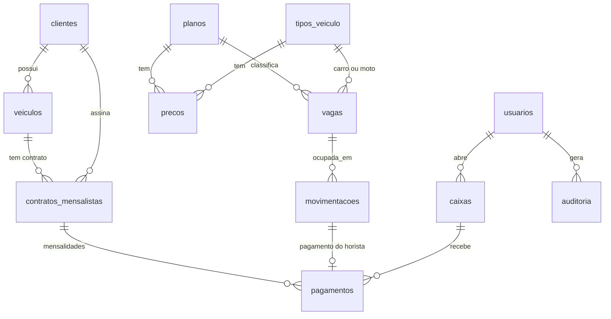

# Banco de dados

| Arquivo | Para quê |
|---|---|
| `schema.sql` | Estrutura completa (estado após a migração 006). Use em **instalação nova**. |
| `migracoes/000_verificacoes_integridade.sql` | Só consultas: procura dados inconsistentes antes de migrar. |
| `migracoes/001_rastreabilidade_e_indices.sql` | Colunas de cancelamento/justificativa e índices de desempenho. |
| `migracoes/002_bloqueio_login.sql` | Contagem de tentativas e bloqueio temporário de login. |
| `migracoes/003_pessoa_fisica_juridica.sql` | `clientes.tipo_pessoa` e `cpf` → `documento` (CPF ou CNPJ). |
| `migracoes/004_configuracoes_estabelecimento.sql` | Dados do recibo e dias de carência de atraso. |
| `migracoes/005_preferencias_usuario.sql` | Preferências de aparência salvas por usuário (opcional). |
| `migracoes/006_autenticacao_dois_fatores.sql` | Colunas da verificação em duas etapas (opcional). |

## Atualizar um banco que já existe

1. **Backup** (MySQL Workbench: *Server → Data Export*).
2. Execute a `000` e confira se não aponta problemas.
3. Execute `001` a `006` **em ordem**, **antes** de colocar o código novo no ar. A `003` renomeia uma coluna: com o código novo e o banco antigo (ou o contrário) o cadastro de clientes falha.
4. Todas podem ser repetidas sem erro (usam `IF [NOT] EXISTS`; exigem MariaDB, não MySQL 8).

## Aviso sobre o `schema.sql`

Ele foi **reconstruído a partir do código**, não exportado do banco. Linhas marcadas com `[CONFERIR]` são deduções. Para gerar o arquivo oficial:

```bash
python -m scripts.exportar_schema      # grava banco/schema_exportado.sql usando o mysqldump e o .env
```

Compare os dois e, se o exportado estiver certo, passe a versionar ele.

## Visão geral das tabelas


